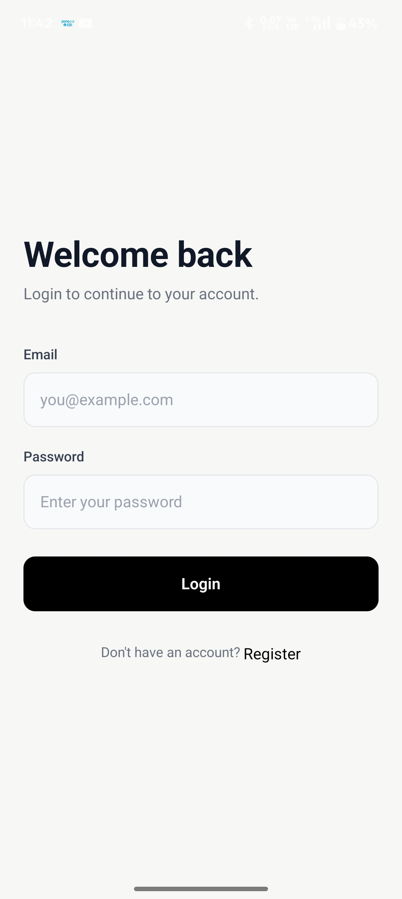
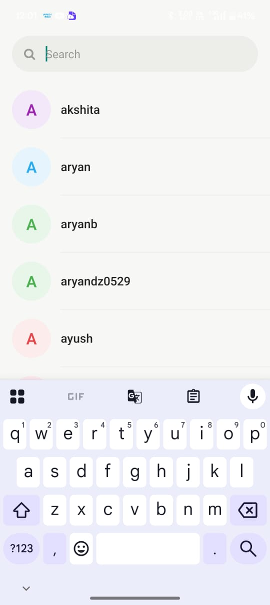
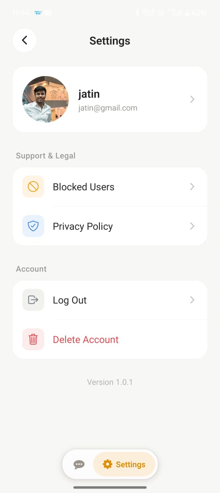

# ChatApp 💬

A real-time mobile messaging application built with **React Native, Expo, and Supabase**. ChatApp provides secure authentication, one-to-one conversations, and instant messaging through a clean, Telegram-inspired interface.

<p align="left">
  <a href="https://github.com/ARYAN0529/react-native-apps/releases/latest">
    
  </a>
  
  
  
</p>

---

## 📸 Screenshots

<p align="center">
  
  
  
  
</p>

---

## ✨ Features

- 🔐 **Authentication** — Email and password-based registration and login.
- 💬 **Real-time Messaging** — Instant message delivery using Supabase Realtime.
- 👥 **One-to-One Conversations** — Private conversations between users.
- 🔍 **User Discovery** — Search registered users and start conversations.
- 🗄️ **Persistent Storage** — Messages and conversations stored in PostgreSQL.
- 🔒 **Row Level Security** — Database access controlled through Supabase RLS policies.
- 🎨 **Modern Interface** — Telegram-inspired chat list and message bubbles.
- 📱 **Android Support** — Installable Android APK built using Expo EAS.

---

## 🛠️ Tech Stack

| Category | Technology |
|---|---|
| Framework | React Native |
| Development Platform | Expo |
| Navigation | Expo Router |
| Language | TypeScript |
| Backend | Supabase |
| Database | PostgreSQL |
| Authentication | Supabase Auth |
| Real-time Communication | Supabase Realtime |
| State Management | Zustand |
| Styling | NativeWind |
| Build & Deployment | Expo EAS |

---

## 📂 Project Structure

```text
react-native-apps/
│
├── README.md
│
└── chatApp/
    ├── app/
    │   ├── (auth)/
    │   │   ├── _layout.tsx
    │   │   ├── login.tsx
    │   │   └── register.tsx
    │   ├── (drawer)/
    │   │   ├── (tabs)/
    │   │   │   ├── _layout.tsx
    │   │   │   ├── index.tsx
    │   │   │   └── two.tsx
    │   │   └── _layout.tsx
    │   ├── chat/
    │   │   └── [id].tsx
    │   ├── users.tsx
    │   └── _layout.tsx
    │
    ├── components/
    ├── database/
    │   └── schema.sql
    ├── screenshots/
    │   ├── login.jpeg
    │   ├── chats.jpeg
    │   ├── search.jpeg
    │   └── setting.jpeg
    ├── store/
    │   └── store.ts
    ├── utils/
    │   └── supabase.ts
    ├── global.css
    └── package.json
```

---

## 🗄️ Database Schema

ChatApp uses PostgreSQL through Supabase.

### Database Tables

| Table | Description |
|---|---|
| `profiles` | Stores user profile information |
| `conversations` | Stores conversation records |
| `conversation_members` | Manages conversation participants |
| `messages` | Stores individual messages |

### RPC Functions

- `get_my_conversations()` — Retrieves the current user's conversations along with the latest message.
- `get_conversation_partner(conv_id)` — Retrieves the other participant in a conversation.

### Security

Row Level Security (RLS) policies restrict access to conversations and messages based on conversation membership.

---

## ⚙️ Getting Started

### Prerequisites

- Node.js (compatible with your Expo SDK)
- npm
- Supabase account
- Android device or emulator

### 1. Clone the Repository

```bash
git clone https://github.com/ARYAN0529/react-native-apps.git

cd react-native-apps/chatApp
```

### 2. Install Dependencies

```bash
npm install
```

### 3. Configure Environment Variables

Create a `.env` file inside the `chatApp` directory.

```env
EXPO_PUBLIC_SUPABASE_URL=your_supabase_url
EXPO_PUBLIC_SUPABASE_ANON_KEY=your_supabase_anon_key
```

Never commit your actual environment credentials to GitHub.

### 4. Start the Development Server

ChatApp uses an Expo development build.

```bash
npx expo start --dev-client
```

---

## 🔧 Supabase Configuration

1. Create a new project in Supabase.
2. Execute `database/schema.sql` in the Supabase SQL Editor.
3. Enable Realtime for the `messages` table.
4. Configure your Supabase project URL and publishable/anon key in `.env`.
5. Ensure the required Row Level Security policies are enabled.

---

## 📡 Real-time Messaging Architecture

ChatApp uses Supabase Realtime to deliver messages without requiring manual refresh.

```text
       User sends a message
                |
                ▼
      Insert into messages table
                |
                ▼
        Supabase Realtime
                |
                ▼
       WebSocket broadcast
                |
                ▼
      Recipient receives event
                |
                ▼
        Chat UI updates instantly
```

---

## 📦 Android APK

The Android application is built using Expo Application Services (EAS).

### Build APK

```bash
eas login
eas build -p android --profile preview
```

Configure the required environment variables in EAS before building.

### Download Latest Release

<p>
  <a href="https://github.com/ARYAN0529/react-native-apps/releases/latest">
    
  </a>
</p>

---

## 🚀 Future Improvements

- [ ] Push notifications
- [ ] Image and file sharing
- [ ] Online/offline user status
- [ ] Typing indicators
- [ ] Group conversations
- [ ] Message read receipts

---

## 👨‍💻 Author

**Aryan Sharma**

Full Stack Developer | React Native Developer

[GitHub Profile](https://github.com/ARYAN0529)

---

## 📄 License

This project is licensed under the MIT License.